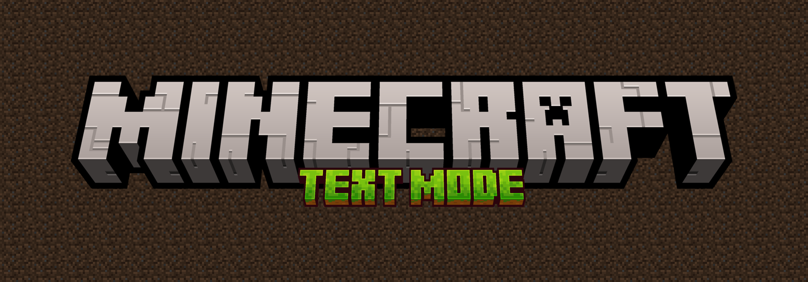

# 我的世界：文字模式

Minecraft 题材的文字增量放置游戏，基于 React、Vite 和 Zustand。采集资源、制作装备、建立村庄，从初生森林一路探索下界与末地，挑战末影龙并建成纪念碑。

**[在线试玩 →](https://mc.llx.life)**

## 开始运行

需要 Node.js 22.18+ 和 pnpm。

```sh
pnpm install
pnpm dev
```

```sh
pnpm test    # 检查游戏数据与资源
pnpm build   # 类型检查与生产打包
pnpm preview # 预览生产构建
```

## 主要玩法

- **生存与制造**：采集、种植、烹饪、合成、熔炼和附魔，升级装备并建立营地。
- **村庄经营**：自行建立庇护所并招募住民，或以访客身份在村里交易、交谈，选择定居后再安排岗位并开启红石产线。
- **探索与远征**：在采集页探索当前位置，在地图页循线索远行、标记或回访地点。可以潜水、考古、挑战试炼，也能派队远征。
- **下界与末地**：收集传送门材料、打造下界合金装备、挑战末影龙，完成纪念碑工程。
- **储存、配方书与成就**：管理随身背包和本地库存，查找配方、材料来源与进度目标。

游戏采用独立的行动冷却、战斗数值、建筑成本和掉落规则。

## 存档与离线进度

进度自动保存在当前浏览器，可在设置中导出或载入 JSON 存档。

每次离线最多结算 8 小时。种植、村民生产与迁入、红石产线、熔炉和远征继续推进，受原料、燃料、口粮与仓储限制。战斗暂停，离线期间不会触发袭击。返回游戏后可查看结算结果。

## 资源与致谢

- 右上角菜单图标使用 Crusenho（Agus Hennihuno）的 [Icons Essential Pack v1.2](https://crusenho.itch.io/icons-essential-pack-free-icons)，遵循 [CC BY 4.0](https://creativecommons.org/licenses/by/4.0/)。使用原始图像，仅在界面中等比放大，许可文件保留在 `public/textures/icons-essential/LICENSE.txt`。
- 界面组件来自 [grasscn](https://github.com/nicognaW/grasscn)，组件源码的 MIT 许可保留在 `src/components/minecraft/LICENSE`。
- 中文名称参考 [中文 Minecraft Wiki](https://zh.minecraft.wiki/)，界面使用 Fusion Pixel 字体。
- 贴图来自 [Minecraft 资源镜像](https://github.com/InventivetalentDev/minecraft-assets/tree/1.21.4/assets/minecraft/textures)、[Mojang 示例资源包](https://github.com/Mojang/bedrock-samples)、[Minecraft Item Gallery](https://mcitemgallery.com/docs/) 和 [Minecraft Wiki](https://minecraft.wiki/w/Help:Isometric_renders)。详细来源见 `public/textures/minecraft/sources.json`。

Minecraft 贴图的权利归 Mojang/Microsoft 所有。
